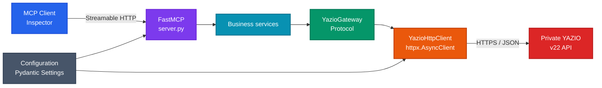

# YAZIO MCP

An unofficial Python MCP server for exploring YAZIO data through its private
v22 API.

> [!WARNING]
> YAZIO does not provide a public API. The routes used here can change without
> notice. Never write to a real account without the user's explicit consent.

## Current status

The server currently provides:

- FastMCP 4 over Streamable HTTP at `http://127.0.0.1:8000/mcp`;
- a `GET /health` route and a local `health_check` tool;
- five read-only tools: profile, summary, diary, product search, and product
  details;
- adding a consumed product and verified deletion of an entry;
- an asynchronous HTTP client with OAuth authentication and refresh;
- configuration and Pydantic models that tolerate unknown fields;
- local and simulated-HTTP tests, with no connection to a real account.

All five reads are covered locally and have been successfully run read-only
against the private v22 API. This live validation is only a smoke test: it
does not guarantee route or schema stability, or every parameter combination.

HTTP-simulated tests cover mutations. During the manual test session described
below, a product added through MCP was accepted and appeared in
`get_user_consumed_items`. MCP deletion and manual-food creation have not
been tested against a real account. The automated test commands were not run
again during that session.

### Manual validation of product addition

On November 1, 2026, MCP addition calls initially failed with HTTP 400 when a
date was passed as `daytime`; YAZIO expects a meal slot there. With
`daytime: "snack"`, `serving: "gram"`, and a `serving_quantity` equal to the
amount, the MCP entry subsequently appeared in `get_user_consumed_items` with
`type: "product"` and the expected values. A native application capture
showed the same functional fields.

The mobile application did not immediately refresh its widget after MCP added
the entry. Closing and reopening the app made the entry appear. Daily-summary
reads were identical in the comparisons performed. This test does not explain
why the UI lagged, nor can it be generalized to other app or API versions.

Network traffic was inspected with mitmproxy. Captures can contain OAuth tokens
and health data: do not share or commit them.

The detailed plan and contribution rules are in [AGENTS.md](AGENTS.md).

## Architecture



The routes remain community observations of the private v22 API and can change
without notice.

## MCP tools

| Tool | Parameters | Effect |
|---|---|---|
| `health_check` | none | Local check, without calling YAZIO |
| `get_user` | none | Reads the authenticated user profile |
| `get_user_daily_summary` | `day` (`YYYY-MM-DD`) | Reads the daily nutrition summary |
| `get_user_consumed_items` | `day` (`YYYY-MM-DD`) | Reads the three diary item categories |
| `search_products` | `query`, `sex`, `countries`, optional `locales` | Searches YAZIO products |
| `get_product` | `product_id` | Reads product details and nutrients per base unit |
| `add_consumed_product` | product, amount, meal, and local time | Adds and verifies a product |
| `delete_consumed_item` | `day`, category, and identifier | Deletes and verifies a diary entry |

`sex` and `countries` are required for search according to community
observations. When supplied, `locales` is also sent as `Accept-Language`
because it affects result ranking.

Write tools modify the configured account. They must only be called after the
exact operation has been presented and the user has agreed. `consumed_at` uses
a local time without a time-zone offset in the `YYYY-MM-DDTHH:MM:SS` format.

## Installation and startup

Prerequisites: Python 3.10 or later and [`uv`](https://docs.astral.sh/uv/).

```bash
uv sync --dev
uv run yazio-mcp
```

To test the server with MCP Inspector, leave the server running and run this
in a second terminal:

```bash
npx --yes @modelcontextprotocol/inspector \
  --transport http \
  --server-url http://127.0.0.1:8000/mcp \
  --protocol-era legacy
```

To prepare local YAZIO configuration:

```bash
cp .env.example .env
```

Then set `YAZIO_USERNAME` and `YAZIO_PASSWORD` in `.env`. Git ignores this
file. The provided `User-Agent` is an observed, unstable value and must be
replaced if YAZIO returns `version_blocked`.

Network options:

```bash
uv run yazio-mcp --host 127.0.0.1 --port 8080 --path /mcp
```

Local check:

```bash
curl http://127.0.0.1:8000/health
```

Expected response:

```json
{"status":"ok","service":"yazio-mcp"}
```

## Quality checks

```bash
uv run pytest
uv run ruff check .
uv run mypy src tests
```

Community reference:
[yazio-api-specification](https://github.com/yazio-community/yazio-api-specification).
