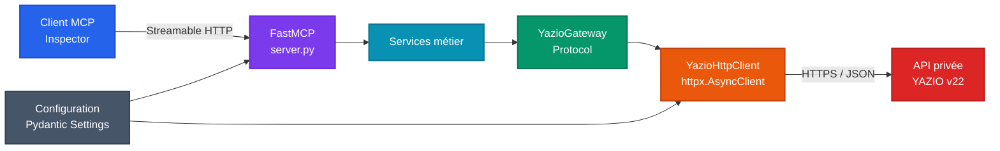

# YAZIO MCP

Serveur MCP non officiel en Python pour explorer les données YAZIO via son
API privée v22.

> [!WARNING]
> YAZIO ne fournit pas d’API publique. Les routes utilisées ici peuvent changer
> sans préavis. Aucune écriture sur un compte réel ne doit être effectuée sans
> accord explicite de l’utilisateur.

## État actuel

Les phases 1 à 4 sont terminées :

- serveur FastMCP 4 en Streamable HTTP ;
- endpoint MCP `http://127.0.0.1:8000/mcp` ;
- route HTTP `GET /health` et outil MCP `health_check` ;
- tests locaux avec pytest ;
- contrôles Ruff et mypy ;
- aucun appel à YAZIO pour les contrôles de santé.
- configuration YAZIO validée avec `pydantic-settings` et secrets masqués ;
- modèles Pydantic pour l’authentification, l’utilisateur, les produits, le
  journal et le résumé quotidien ;
- fixtures sanitisées et validation locale tolérante aux champs inconnus ;
- aucune connexion à YAZIO dans les tests standards.
- port asynchrone `YazioGateway` pour les lectures du MVP ;
- client HTTP partagé avec authentification, expiration et refresh OAuth ;
- erreurs applicatives stables, dont `version_blocked` ;
- tests d’intégration HTTP entièrement simulés avec `respx`.
- cinq lectures v22 exposées comme outils MCP : profil, résumé quotidien,
  journal, recherche de produits et détail d’un produit ;
- authentification Bearer partagée, dates ISO et localisation de la recherche ;
- réponses nominales, partielles et erronées couvertes sans compte réel.

Le plan détaillé et les règles de contribution se trouvent dans
[AGENTS.md](AGENTS.md).

## Architecture



La couche FastMCP, les contrôles de santé, la configuration, les modèles, le
port, l’authentification HTTP et les cinq lectures du MVP sont implémentés. Les
routes restent des observations communautaires de l’API privée v22 et peuvent
changer sans préavis.

## Outils MCP

| Outil | Paramètres | Effet |
|---|---|---|
| `health_check` | aucun | Contrôle local, sans appel à YAZIO |
| `get_user` | aucun | Lit le profil authentifié |
| `get_user_daily_summary` | `day` (`YYYY-MM-DD`) | Lit le résumé quotidien |
| `get_user_consumed_items` | `day` (`YYYY-MM-DD`) | Lit les trois catégories du journal |
| `search_products` | `query`, `sex`, `countries`, `locales` optionnel | Recherche des produits |
| `get_product` | `product_id` | Lit un produit et ses nutriments par unité de base |

`sex` et `countries` sont obligatoires pour la recherche selon les observations
communautaires. `locales`, lorsqu’il est fourni, est aussi transmis comme
`Accept-Language` car il influence le classement des résultats.

## Installation et lancement

Prérequis : Python 3.10 ou plus récent et
[`uv`](https://docs.astral.sh/uv/).

```bash
uv sync --dev
uv run yazio-mcp
```

Pour préparer la configuration YAZIO locale :

```bash
cp .env.example .env
```

Renseignez ensuite `YAZIO_USERNAME` et `YAZIO_PASSWORD` dans `.env`. Ce fichier
est ignoré par Git. Le `User-Agent` fourni est une valeur observée et instable :
il devra être remplacé si YAZIO renvoie `version_blocked`.

Options réseau :

```bash
uv run yazio-mcp --host 127.0.0.1 --port 8080 --path /mcp
```

Vérification locale :

```bash
curl http://127.0.0.1:8000/health
```

Réponse attendue :

```json
{"status":"ok","service":"yazio-mcp"}
```

## Qualité

```bash
uv run pytest
uv run ruff check .
uv run mypy src tests
```

Référence communautaire :
[yazio-api-specification](https://github.com/yazio-community/yazio-api-specification).
