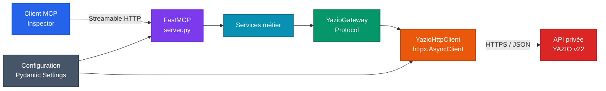

# YAZIO MCP

Serveur MCP non officiel en Python pour explorer les données YAZIO via son
API privée v22.

> [!WARNING]
> YAZIO ne fournit pas d’API publique. Les routes utilisées ici peuvent changer
> sans préavis. Aucune écriture sur un compte réel ne doit être effectuée sans
> accord explicite de l’utilisateur.

## État actuel

Le serveur fournit actuellement :

- FastMCP 4 en Streamable HTTP sur `http://127.0.0.1:8000/mcp` ;
- route `GET /health` et outil local `health_check` ;
- cinq outils de lecture : profil, résumé, journal, recherche et produit ;
- ajout d’un produit consommé et suppression vérifiée d’une entrée ;
- client HTTP asynchrone avec authentification et refresh OAuth ;
- configuration et modèles Pydantic tolérants aux champs inconnus ;
- tests locaux et HTTP simulés, sans connexion à un compte réel.

Les cinq lectures sont couvertes localement et ont été exécutées avec succès en
lecture seule face à l’API privée v22. Cette validation live reste un smoke
test : elle ne garantit ni la stabilité des routes et schémas, ni toutes les
combinaisons de paramètres.

Des tests avec HTTP simulé existent pour les mutations. Pendant la session de
test manuel décrite ci-dessous, un ajout de produit MCP a été accepté et
l’entrée est apparue dans `get_user_consumed_items`. La suppression MCP et
l’ajout d’une entrée manuelle n’ont pas été testés sur un compte réel. Les
commandes de tests automatisés n’ont pas été relancées pendant cette session.

### Validation manuelle de l’ajout d’un produit

Le 1er novembre 2026, les appels d’ajout MCP ont d’abord échoué avec HTTP 400
quand une date était passée dans `daytime`; YAZIO attend ici un créneau de
repas. Avec `daytime: "snack"`, `serving: "gram"` et une
`serving_quantity` égale à la quantité, l’entrée MCP est ensuite apparue dans
`get_user_consumed_items` avec `type: "product"` et les valeurs attendues.
Une capture native de l’application montrait les mêmes champs fonctionnels.

L’application mobile n’a pas immédiatement actualisé son widget après l’ajout
MCP. Fermer puis rouvrir l’application a fait apparaître l’entrée. Les lectures
du résumé quotidien étaient identiques dans les comparaisons effectuées. Ce
test ne permet pas d’établir pourquoi l’interface était en retard, ni de
généraliser ce comportement à d’autres versions de l’application ou de l’API.

Le flux réseau a été inspecté avec mitmproxy. Les captures peuvent contenir
des jetons OAuth et des données de santé : ne pas les partager ni les committer.

Le plan détaillé et les règles de contribution se trouvent dans
[AGENTS.md](AGENTS.md).

## Architecture



Les routes restent des observations communautaires de l’API privée v22 et
peuvent changer sans préavis.

## Outils MCP

| Outil | Paramètres | Effet |
|---|---|---|
| `health_check` | aucun | Contrôle local, sans appel à YAZIO |
| `get_user` | aucun | Lit le profil authentifié |
| `get_user_daily_summary` | `day` (`YYYY-MM-DD`) | Lit le résumé quotidien |
| `get_user_consumed_items` | `day` (`YYYY-MM-DD`) | Lit les trois catégories du journal |
| `search_products` | `query`, `sex`, `countries`, `locales` optionnel | Recherche des produits |
| `get_product` | `product_id` | Lit un produit et ses nutriments par unité de base |
| `add_consumed_product` | produit, quantité, repas et heure locale | Ajoute puis vérifie un produit |
| `delete_consumed_item` | `day`, catégorie et identifiant | Supprime puis vérifie une entrée |

`sex` et `countries` sont obligatoires pour la recherche selon les observations
communautaires. `locales`, lorsqu’il est fourni, est aussi transmis comme
`Accept-Language` car il influence le classement des résultats.

Les outils d’écriture modifient le compte configuré. Ils ne doivent être
appelés qu’après présentation de l’opération exacte et accord explicite de
l’utilisateur. `consumed_at` utilise une heure locale sans fuseau au format
`YYYY-MM-DDTHH:MM:SS`.

## Installation et lancement

Prérequis : Python 3.10 ou plus récent et
[`uv`](https://docs.astral.sh/uv/).

```bash
uv sync --dev
uv run yazio-mcp
```

Pour tester le serveur avec MCP Inspector, laissez le serveur tourner puis
lancez dans un second terminal :

```bash
npx --yes @modelcontextprotocol/inspector \
  --transport http \
  --server-url http://127.0.0.1:8000/mcp \
  --protocol-era legacy
```

Pour préparer la configuration YAZIO locale :

```bash
cp .env.example .env
```

Renseignez ensuite `YAZIO_USERNAME` et `YAZIO_PASSWORD` dans `.env`. Ce fichier
est ignoré par Git. Le `User-Agent` fourni est une valeur observée et instable :
il devra être remplacé si YAZIO renvoie `version_blocked`.

Options réseau :

```bash
uv run yazio-mcp --host 127.0.0.1 --port 8080 --path /mcp
```

Vérification locale :

```bash
curl http://127.0.0.1:8000/health
```

Réponse attendue :

```json
{"status":"ok","service":"yazio-mcp"}
```

## Qualité

```bash
uv run pytest
uv run ruff check .
uv run mypy src tests
```

Référence communautaire :
[yazio-api-specification](https://github.com/yazio-community/yazio-api-specification).
