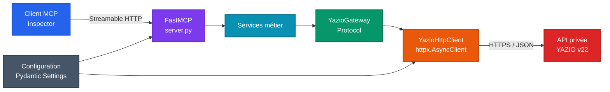

# YAZIO MCP

Serveur MCP non officiel en Python pour explorer les données YAZIO via son
API privée v22.

> [!WARNING]
> YAZIO ne fournit pas d’API publique. Les routes utilisées ici peuvent changer
> sans préavis. Aucune écriture sur un compte réel ne doit être effectuée sans
> accord explicite de l’utilisateur.

## État actuel

La phase 1 est terminée :

- serveur FastMCP 4 en Streamable HTTP ;
- endpoint MCP `http://127.0.0.1:8000/mcp` ;
- route HTTP `GET /health` et outil MCP `health_check` ;
- tests locaux avec pytest ;
- contrôles Ruff et mypy ;
- aucun appel à YAZIO pour les contrôles de santé.

Le plan détaillé et les règles de contribution se trouvent dans
[AGENTS.md](AGENTS.md).

## Architecture



Seule la couche FastMCP et les contrôles de santé sont implémentés pour le
moment. Les autres blocs représentent l’architecture cible.

## Installation et lancement

Prérequis : Python 3.10 ou plus récent et
[`uv`](https://docs.astral.sh/uv/).

```bash
uv sync --dev
uv run yazio-mcp
```

Options réseau :

```bash
uv run yazio-mcp --host 127.0.0.1 --port 8080 --path /mcp
```

Vérification locale :

```bash
curl http://127.0.0.1:8000/health
```

Réponse attendue :

```json
{"status":"ok","service":"yazio-mcp"}
```

## Qualité

```bash
uv run pytest
uv run ruff check .
uv run mypy src tests
```

Référence communautaire :
[yazio-api-specification](https://github.com/yazio-community/yazio-api-specification).
